<a href="https://burhansahin.com.tr/">
  <picture>
    <source media="(prefers-color-scheme: dark)" srcset="assets/gorseller/kahraman-koyu.svg">
    
  </picture>
</a>

C# ve .NET ile backend, TypeScript ve React ile arayüz yazıyorum. En çok az kaynakla çalışan, kurması kolay ve kendi sunucunda barınan araçlar yapmayı seviyorum.

### Öne çıkan proje

<a href="https://github.com/koyhq/koy">
  <picture>
    <source media="(prefers-color-scheme: dark)" srcset="assets/gorseller/koy-koyu.svg">
    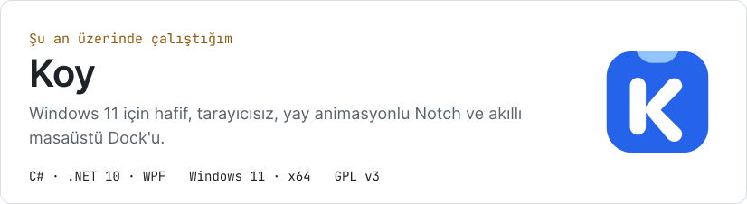
  </picture>
</a>

### Diğer projeler

  <a href="https://github.com/brhnshn/ApiHub"><picture><source media="(prefers-color-scheme: dark)" srcset="assets/gorseller/apihub-koyu.svg">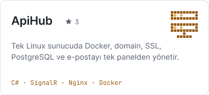</picture></a>
  <a href="https://github.com/brhnshn/corvus"><picture><source media="(prefers-color-scheme: dark)" srcset="assets/gorseller/corvus-koyu.svg">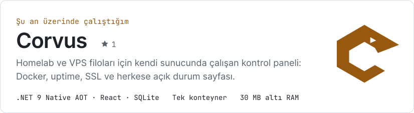</picture></a>
  <a href="https://github.com/brhnshn/AulaTray"><picture><source media="(prefers-color-scheme: dark)" srcset="assets/gorseller/aulatray-koyu.svg">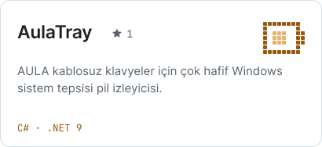</picture></a>
  <a href="https://github.com/brhnshn/NetPulse"><picture><source media="(prefers-color-scheme: dark)" srcset="assets/gorseller/netpulse-koyu.svg">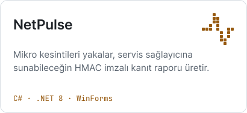</picture></a>
  <a href="https://github.com/brhnshn/GoBurhan"><picture><source media="(prefers-color-scheme: dark)" srcset="assets/gorseller/goburhan-koyu.svg">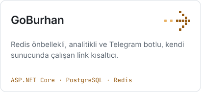</picture></a>
  <a href="https://github.com/brhnshn/QRMenu"><picture><source media="(prefers-color-scheme: dark)" srcset="assets/gorseller/qrmenu-koyu.svg">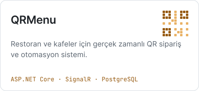</picture></a>

### Kullandığım teknolojiler

<picture>
  <source media="(prefers-color-scheme: dark)" srcset="assets/gorseller/yigin-koyu.svg">
  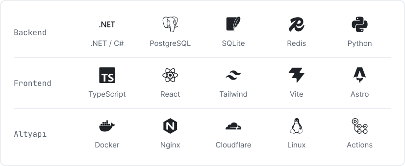
</picture>

### Rakamlarla

<picture>
  <source media="(prefers-color-scheme: dark)" srcset="assets/gorseller/istatistik-koyu.svg">
  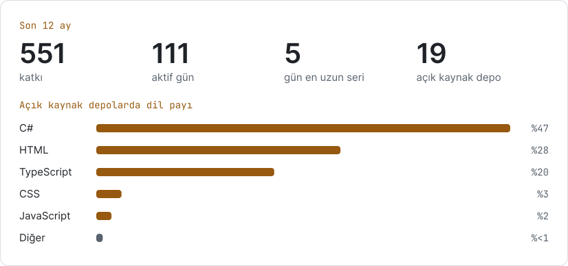
</picture>

### İletişim

  <a href="https://burhansahin.com.tr/"><picture><source media="(prefers-color-scheme: dark)" srcset="assets/gorseller/iletisim-site-koyu.svg">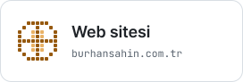</picture></a>
  <a href="https://www.linkedin.com/in/burhan-sahin/"><picture><source media="(prefers-color-scheme: dark)" srcset="assets/gorseller/iletisim-linkedin-koyu.svg">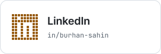</picture></a>
  <a href="mailto:sahinburhan501@gmail.com"><picture><source media="(prefers-color-scheme: dark)" srcset="assets/gorseller/iletisim-eposta-koyu.svg">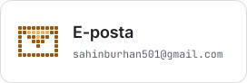</picture></a>

